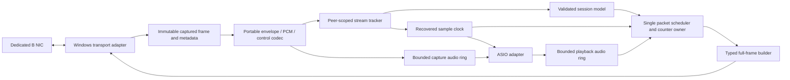

# Implementation plan: fresh Windows REAC / FL Studio interface

Draft 1, 6 November 2026. Intended outcome: one Windows endpoint with **40 mono
ASIO inputs and 40 mono ASIO outputs**, M-400 FOH master, real S-1608 on REAC A,
software slave on the **separate REAC B**, initial hardware work at **48 kHz**.
This plan extends the existing C++20/CMake/CTest implementation; it does not fork
the legacy project. User communication is Hungarian; engineering documents and
source comments are English.

**Status:** the offline foundation and new passive evidence are available. A
fresh line-by-line review of the newly attached legacy ZIP is blocked by its
32 MiB transfer limit. The [reassessment](reports/Legacy_Reassessment_2026-11-06_EN.md)
separates direct current-code observations, historical source findings, new
measurements and owner reports. Tasks below do not pretend that review is done.

## 1. Decisions and boundaries

| Decision | Current choice / evidence | Change condition |
|---|---|---|
| Implementation | New portable C++20 core plus thin platform adapters; keep CMake/CTest | A demonstrated platform constraint, not legacy coupling |
| Capture/transport | Npcap is the initial Windows passive-backend candidate, isolated behind an interface | SDK/runtime terms and measured NIC behavior must be checked before distribution/active timing commitments |
| Protocol model | Typed messages and peer/session-scoped state; all raw evidence retained externally | New complete validated record families, not opcode-name guesses |
| Geometry | Explicit RX/TX geometry with evidence and session generation | A tested device/profile can resolve it; short silent frames alone cannot |
| Rate/clock | One console-derived sample timebase; derive cadence per geometry | Explicitly measured clock bridging if a single domain is infeasible |
| Audio routing | One deliberate map per direction, no implicit bank duplication/monitor fallback | A user-chosen, documented route only |
| UI | CLI diagnostics and structured logs first; no GUI prerequisite | After transport/session/audio gates pass |
| ASIO | Last integration layer, bitness matching the actual FL Studio host | Never used to mask unresolved endpoint/session behavior |

40-wide payload, host channel count, declared stagebox inventory and console
patch exposure are different facts. The 40/0 and 40/8 profile ideas are
**experiments**, not selected proven identities. The historical builder's
48-inventory-cell limit does not establish a shared 48-channel transport limit.
If neither ordinary profile permits forty independent B outputs, investigate an
appropriate representable bridge identity using permitted references and actual
patch evidence; do not hide inaccessible routes behind forty host channel names.

The M-400 has 48 processing strips. Sixteen live stagebox sources plus forty
independent return strips require 56. Define separate patches for a 40x40 link
verification, virtual soundcheck and normal live mixing. SPLIT's measured +8
forwarding at four tested sockets is not a default B-port map.

## 2. Evidence register and unresolved decisions

| ID | Evidence or question | Status / action |
|---|---|---|
| E01 | Public pinned PCM/control fixtures and M1 tests | Available; preserve independent digests and negative cases |
| E02 | New original H02/H03 captures | Fully read; [audit](reports/Release_Capture_Audit_2026-11-06_EN.md) records hashes, counts, controls and limits |
| E03 | Owner's socket order and emulator stopped | Supports tested SPLIT mapping 1→9, 2→10, 9→17, 16→24; not original upstream geometry |
| E04 | Old emulator sustained slave connection | Owner-reported; recover exact binary/source/configuration and whether bidirectional audio ran |
| E05 | New legacy ZIP | Not readable through current transfer; fresh source review pending |
| E06 | Original stagebox request/reply and maintenance sequence | Absent from passive downstream captures; use an identifiable successful emulator trace or H01 if a tap/mirror is already available |
| E07 | Firmware, B patch screenshots, input/output inventory exposure | Required before selecting/claiming the forty-route identity; missing details stay unknown |
| E08 | Windows x64 evidence | Separate repository note reports M1 Release on Windows; this environment's builds/tests are Linux. New adapters require their own Windows runs |
| E09 | FL Studio version/bitness, Windows/NIC/driver/runtime versions | Record before host/active backend validation; does not block portable work |
| E10 | Why the legacy connection eventually drops | Competing clock, counter, deadline, control and capture hypotheses. No current trace attributes a cause or defines a timeout |

H01 is useful if the owner already has a suitable mirror/tap; purchasing equipment
is not a prerequisite for the offline tasks. Do not repeat H02/H03 just to gather
the information they already establish. If old successful/failing traces exist,
review those before asking the owner to reproduce them.

## 3. Component contracts

The diagram is the target design. Today only the offline codec/CLI and Python
import/audit tools exist. None of its arrows imply a running network transmitter.

- **Capture record:** immutable bytes, section/interface/link type, timestamps
  with resolution, captured/original lengths, VLAN/FCS/residue provenance and
  original packet ordinal. A malformed record stays diagnosable; no header repair.
- **Codec:** bounded, deterministic transformations. Keep envelope, geometry,
  integrity, recognized family and semantic validity separate. A validated event
  must be constructed explicitly; unchecked/unknown data cannot enter an FSM.
- **Stream context:** interface/VLAN/peer/direction/session generation, sequence
  classification, geometry evidence and sample position. A rate change or peer
  restart invalidates stale context. Duplicates do not become 65535 lost packets.
- **Scene receiver:** peer-scoped FIRST/MIDDLE/LAST assembly with bounded size,
  fragment/boundary diagnostics and interruption handling. Interleaved filler is
  allowed. Missing fragments remain missing; length completeness is not commit.
- **Session model:** pure inputs/events and explicit scheduled intents. Log the
  reason for each transition, peer, state, source packet and deadline. Separate
  syntactic recognition, join/configuration semantics, established maintenance
  and audio-clock lock. A checksum/GRANT label/box-count field alone is insufficient.
- **Clock:** track master packet observations as sample positions using validated
  geometry. Record observation uncertainty, lock/acquiring/holdover states and
  separate capture arrival from physical TX timing. Host time is an observation,
  not a substitute console oscillator.
- **Scheduler:** one owner allocates packet sequence and sample intervals. Control
  changes the required fields of a scheduled frame; it does not allocate an extra
  audio slot or discard that slot's PCM. Identity/control replies become queued
  intents with evidenced deadlines; no second direct sender.
- **Rings and block adapter:** bounded operations and explicit underflow/overflow
  policy. Preserve callback residuals across packet boundaries; define startup
  prefill, stale-data flushing, generation changes and discontinuity reporting.
- **ASIO adapter:** one full-duplex endpoint. No network blocking, dynamic buffer
  allocation or log/file I/O in the real-time callback. DAW start/stop does not
  own network enrollment. Handle callback thread rules and sample position from
  the actual Windows/ASIO contract, not an independent free-running timer.

Do not hardcode a protocol FSM sequence from the diagram. Initial conceptual
states can be observing, discovering, configuring, joining, established,
recovering and backoff; exact events, message requirements, deadlines and peer
scope require the evidence work below. Clock lock and host run/stop are separate
state dimensions to avoid a misleading single `connected` flag.

## 4. Ordered implementation and acceptance gates

Milestones retain the original M1–M5 meaning. Substeps below make the next work
reviewable without silently claiming that the missing old source was inspected.
There is no fixed time estimate until source access and target-host evidence are
available. Each step ends with a usable artifact and an explicit result.

### S0: fresh legacy review (source-dependent)

Deliver: archive/file manifest, actual executable/configuration call graph,
claim-versus-code table and a reconstruction of the reported successful path.
Review TX templates, handshake/maintenance triggers, counter ownership, clock,
queues, routing and ASIO lifetime; distinguish code used by the ASIO driver from
standalone probes/dead helpers. Preserve source outside the public checkout.

Acceptance: every retained old-code claim cites this supplied version; exact
successful binary/profile is identified or explicitly unknown. Historical defects
are rechecked rather than inherited. This blocks conclusions about the old
program; it does **not** block M1.1 or other evidence-independent portable work.

### M1.1: strengthen the offline contract (next implementation step)

Deliver small separate changes in this order:

1. Replace ambiguous validation booleans for live-facing use with explicit status
   types. Preserve existing CLI consumers through documented schema changes.
   A geometry failure must not report an unchecked control as valid.
2. Separate envelope/control diagnostics from a particular audio interpretation.
   Preserve valid controls on a mixed 340/1492 trace while keeping short audio
   ambiguous. Add explicit typed RQ1 requests and unknown-command metadata.
3. Add a typed **offline full-frame builder**, with no NIC calls. Begin with a
   documented filler policy and only control families with complete field rules;
   do not invent a universal filler descriptor or build master scenes for a slave.
   Geometry, source/destination, VLAN representation, sequence and audio are inputs.
   Strictly reject capture residue as payload and invalid lengths/sample ranges.
4. Add peer-scoped counter tracking and deterministic replay events. Follow with
   a scene receiver that distinguishes incomplete, interrupted, length-complete
   and semantically recognized results.

Acceptance: existing 17 public PCM hashes remain unchanged; malformed/unknown
controls cannot become eligible events; all built frames are decoded and checked
against independent field/checksum expectations, not only a self-round-trip.
Include a known signed ramp across control overlays and all channel/time banks,
340-byte ambiguity, VLAN offsets, length mismatch, bad checksums, wrong peers,
wrap/duplicate/reset/reorder, interrupted scenes and mixed geometry contexts.
Private/legacy capture payloads stay outside public tests.

The full-frame builder makes syntactically valid bytes. It is not a transmitter
or proof of M-400 acceptance. The diagnostic 16x6 path stays diagnostic unless
actual hardware evidence supports its use on the wire.

### M2: Windows passive adapter and replay equivalence

Deliver a dedicated-NIC capture CLI behind the transport interface, adapter
identity/configuration display, timestamp/link metadata and bounded diagnostic
queues. No packet TX in this step. Resolve SDK/runtime requirements and terms
before adding dependencies; keep SDKs/binaries out of the default source tree.

Acceptance: Windows x64 build/tests, offline/live read-path equivalence on saved
frames, accurate PCAPNG metadata, normal non-REAC traffic kept separate, captured
length/driver counters reported, clean stop/restart and no unrequested NIC or
console changes. Record NIC/driver/runtime versions. Capture batching/jitter is
measured and documented, not interpreted as physical loss or latency.

### M3.0: session and clock model before active endpoint

Deliver a pure session simulator using timestamped events, virtual time and
recorded peer identities. Add typed join/configuration/identity/maintenance
handling only as supported by S0/E06. Keep a table per transition: required peer,
state, message grammar, semantics, timer source, evidence and failure response.

Deliver a separate clock model with deterministic simulation: 4000x12 and
3675x12 master observations recover nominal 48/44.1 kHz sample domains; a
6-sample diagnostic TX cadence is derived from samples, not compared directly
to 12-sample master fps. Inject batching, duplicates, gaps, resets and synthetic
frequency offsets. Do not claim PCAP arrival time is a hardware timestamp.

Acceptance: malformed, stale-generation, wrong-peer or merely checksum-valid
records never establish a session; valid PCM continues across maintenance;
control deadlines and clock failure are distinct logged causes. Timeout values
and any hardware profile remain provisional until supported by a matching trace.
Offline simulation may proceed, but active enrollment is blocked on those facts.

### M3.1: minimal coordinated B endpoint

Deliver a distinct software identity and one scheduler, using a profile whose
geometry/control requirements have evidence. Keep real S-1608 on A and preserve
normal FOH operation. Start with one identifiable route in each direction within
that frame geometry; host/packet width can exceed the number of active test tones.

Acceptance: console-visible identity/patch evidence, successful bidirectional
signal routing, sustained control/audio without planned zeroed control slots,
measured ring occupancy/clock behavior, reconnect and no observed disruption to
A/S-1608. Test DAW-independent session lifetime. Log startup, steady state,
maintenance and teardown. A connected display alone does not pass the audio gate.

If it drops, compare the last good exchange and first deviation with the exact
binary/configuration. Determine who stopped first; do not simultaneously change
identity, geometry, clock policy and timeouts. Reuse the old successful trace as
a discriminating reference, not a session script to replay blindly.

### M4: forty independent routes before ASIO integration

Deliver explicit profile/inventory/patch experiment results and a 40-lane route
map. Test 40/0 and, if useful, 40/8 or an alternate representable identity as
separate experiments. Never silently switch profiles to make counts look right.

Acceptance: forty distinguishable mono routes each way simultaneously, verified
at both the wire and console, including slots 9–16 and 33–40. No bank mirroring,
monitor fallback or false channel labels. Save patch availability including gray
positions, scene/reconnect persistence and the console's DSP-strip budget.
A failed patch-exposure experiment blocks the 40x40 claim, not the reporting of
what smaller configuration actually works.

### M5: ASIO / FL Studio and endurance

Deliver one endpoint for the actual FL Studio bitness. Define sample-format,
channel order and twenty stereo-pair/L-R mapping where the host UI uses stereo.
Integrate rings and console-derived sample position without tying session
lifetime to the ASIO callback. Meet the selected SDK/runtime redistribution terms.

Acceptance: random and real host blocks including 64/128/256 and nonmultiples of
packet samples preserve ordering; DAW stop/start does not break enrollment;
underflow/overflow inserts counted silence or follows the explicit recovery
policy without stale playback. Test reconnect, rate changes and device removal.

Use a measured one-hour 40x40 run as the initial engineering target: no unexplained
sample discontinuities, unbounded occupancy drift or recovery failures. Record
load, buffers, profile, patches, capture/drop metrics and exact binary. Measure
round-trip/one-way latency with a suitable physical loopback and documented
method; subtract no unknown capture delay and promise no numerical latency
before measurement. One hour is a test target, not a vendor guarantee.

## 5. First reviewable work items

| Priority | Task | Required input | Result / validation |
|---|---|---|---|
| P0 | Obtain source-only legacy archive and identify the successful path | E05; local binary/configuration identity if available | S0 review; history corrected per actual version |
| P0 | Make validation status unambiguous | Current M1, C01/C04 | Explicit checked/unknown/invalid cases; no unchecked success |
| P0 | Inspect controls independently of audio geometry; model RQ1 | Current M1, E02 | Initial 340-byte controls retained; six requests identified without false ready/grant |
| P1 | Typed offline full-frame generation | Current codec and complete public record rules | Exact length/marker/checksums, independent expectations, continuous control-bearing PCM |
| P1 | Per-peer replay/counter/scene context | Current capture reader and E02 | Distinct gaps/duplicates/restarts; correct interleaving and assembly limits |
| P1 | Evidence-backed transition/maintenance table | S0/E04/E06 | Each transition cites record/version/peer and an observed or explicitly provisional deadline |
| P2 | Windows passive backend spike | Windows/NIC and SDK/runtime terms | Recorded read-path equivalence and acquisition behavior |
| P2 | Clock/ring deterministic simulator | Validated geometry and explicit policies | Units, residuals, drift/underflow/recovery tests before real callbacks |

Prepare code changes as focused commits with tests/results and English docs.
The owner has requested ongoing GitHub updates; publish reviewed new code and
non-sensitive planning material there, while keeping legacy code, SDKs and
private packet payloads outside public commits. A product release and live rig
experiment are distinct actions, not consequences of an offline commit.

## 6. Logging and evidence required for useful diagnosis

For each run record software revision/binary hash, configuration/profile hash,
Windows/NIC/runtime versions, firmware, A/B/SPLIT wiring, console patch and actual
rate. Each event needs packet ordinal, capture timestamp/resolution, interface,
peer/session generation, sequence classification, geometry source, semantic
validation disposition and state-transition reason. Ring/scheduler telemetry
needs sample position, occupancy, clock state, intended/send/capture timing and
counted underflow/overflow/discontinuities. Keep logs bounded and off the audio
callback path. A gap is not automatically a wire loss and an error counter is
not an analogue audibility result.

To discriminate the owner's reported periodic checks, retain enough successful
steady state and the failure boundary to compare maintenance cadence, replies,
scene/configuration changes, master continuity, TX sample position and host
queue state. Determine whether control failure preceded clock/queue trouble or
followed it. Raw records remain unchanged; derived events can be regenerated.

## 7. Definition of the next completion point

The next implementation increment is complete when M1.1 provides reliable
validation dispositions, typed request/write diagnostics and a tested offline
full-frame builder. It does not require buying a tap or installing ASIO.

The next **legacy review** increment is complete only after the actual source
archive is readable and S0 has been performed. The plan remains a draft until
that comparison can confirm or revise the source-dependent design assumptions.
