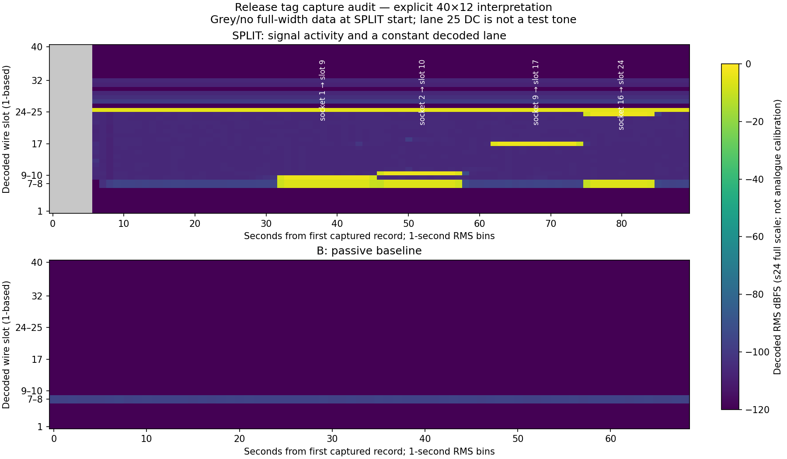

# Release capture audit: SPLIT mapping and passive B baseline

Audit date: 6 November 2026 (Europe/Budapest). Release:
<https://github.com/h-mate25/V-Mixer-audio-tool/releases/tag/tag>.

**Result:** both original PCAPNGs are now accessible and were read in full. They
support the known Ethernet/PCM/control layout, a four-point SPLIT input mapping,
a captured stagebox-arrival-related change, and a useful B baseline. They do
**not** contain the original stagebox-to-console REAC stream or a successful
software-slave session. Correctly formed bytes and a console-accepted endpoint
remain separate gates. No packet was transmitted during this audit.

## Provenance and owner-supplied context

The following release assets were downloaded outside the Git checkout. Their
sizes and SHA-256 digests were checked against the GitHub release metadata:

| Asset | Bytes | SHA-256 |
|---|---:|---|
| `1.Passziv.SPLIT-felvetel.valodi.stageboxszal.-.48kHz.pcapng` | 507793356 | `90e9d1981116fb2b4fafddd5f21b8539bc6f893058e1894d3a69958cff7ce101` |
| `2.Kulon.passziv.B-felvetel.-.48kHz.pcapng` | 420340192 | `a833498e932a93d3d47655888352f4fa6096e92472ad0ece03f7308e9b288001` |
| `01-passive-split-48kHz.inspection.jsonl` | 221159105 | `059cde10aacce4a8c3c2968df505c6013bfefbb6656261054e3c3f54edefc5b8` |
| `02-passive-b-48kHz.inspection.jsonl` | 174731855 | `2d7c27a8e99ba382b115d760258323af6707612ec187286c1a88534b2ba681c3` |

The two release `.frames.hex` assets were not needed or downloaded: frame bytes
were reread directly from the original PCAPNGs. Their hashes are not claimed as
locally verified. No capture, extracted frame, scene body or PCM payload is added
to this Git commit; the figure and this report contain derived observations.

Owner clarification during this audit:

- The stagebox was disconnected for the first few seconds of the SPLIT take.
- After connection and about 30 seconds of operation, the owner applied a signal
  to S-1608 sockets **1, 2, 9, 16**, in that order, each for at least ten seconds,
  with a few seconds needed to move the cable.
- **The emulator was not running.** This is operator-supplied provenance, separate
  from a MAC-based inference. Neither file contains PC-originated REAC frames.
- The source was described as a 0 dB signal from
  <https://youtu.be/PyD9cMarVJk?si=pYPXZJgvjZ2D5esI>.
  The link's contents were not fetched as evidence; the capture itself contains
  approximately 1 kHz tone windows under the stated 48 kHz interpretation.
  Source level is not calibration of the intervening analogue/console path.

Firmware, exact patch screenshots, gain settings and a precise event-time ledger
were not supplied in this exchange. Filename labels alone are not rate evidence;
the validated rate announcements below provide additional on-wire evidence.
The separately authored [passive measurement note](../M1_Passziv_Meresek_HU.md),
now present on GitHub, reports a Windows x64 Release run of M1 and sampled PCM
checks. Its record counts and file hashes agree with this audit. Windows testing
was not performed by this Linux audit; the reported owner-side Windows run and
our host validation are distinct evidence.

The earlier M1 note about the 32 MiB attachment transfer limit remains historical:
these release URLs now allow access to the original files.

## Whole-file envelope and capture checks

Both captures use one Ethernet interface, decimal nanosecond timestamps (IDB
`if_tsresol=9`), no declared FCS, no observed inline VLAN tags, and Enhanced Packet
Blocks with captured length equal to original length. The narrow reader checked
block sizes, footers, packet/interface bounds and option bounds. Interface
statistics report received counts equal to the record totals and `ifdrop=0`.
These statistics do not prove the NIC/path captured every physical wire packet.

| Observation | SPLIT | Passive B |
|---|---:|---:|
| All packet records | 348103 | 275883 |
| Capture duration | 89.9345881 s | 68.9483805 s |
| Normally framed EtherType 8819 records | 348023 | 275806 |
| 340-byte REAC records | 19626 | 0 |
| 1492-byte REAC records | 328397 | 275806 |
| End marker passes on normally framed REAC | 348023 / 348023 | 275806 / 275806 |
| Filler / CDEA / CFEA | 347130 / 804 / 89 | 266816 / 8921 / 69 |
| Non-filler outer checksum passes | 893 / 893 | 8990 / 8990 |
| Valid class-0 announcements | 89 | 69 |

Normally framed REAC is broadcast from `00:40:ab:c4:9c:0a` in SPLIT and
`00:40:ab:c4:9c:0b` in B. There is **no separately observed S-1608-source REAC
stream** in either file. The files also contain ordinary PC LLDP/IP/ARP traffic:
78 records in SPLIT and 77 in B. Those are not damaged REAC.

SPLIT additionally has two **1490-byte records**, original packet numbers 19679
and 19691, whose apparent fields are shifted by two missing Ethernet-header
bytes. The captured/original length fields both say 1490. They are retained as
header-damage candidates, not repaired or added to the normal REAC counts.
Snaplen equality therefore does not establish packet-byte integrity.

## Important correction to the supplied inspection results

The supplied SPLIT JSONL labels 19706 records invalid:

- **19626** are intact 340-byte REAC frames rejected by the requested **40x12**
  geometry. This is an analysis-context mismatch, not 19626 damaged packets.
- **78** are ordinary non-REAC PC records.
- **2** are the header-damage candidates above.

Its 328397 full-width records are valid under 40x12. Five initial CFEA records
were hidden behind that geometry rejection, so the original JSONL exposes only
84 rate announcements while direct control inspection finds 89.

The B JSONL contains 275806 valid full-width records and 77 non-REAC records.
No measured bad REAC packet follows from those 77 `invalid` rows. On a framing or
geometry rejection, M1's default `control.valid=true` is **not a completed
validation**: `outer_checksum=not_checked` and the top-level failure take priority.

The 340-byte audio regions are all zero under both 8x12 and diagnostic 16x6. They
cannot settle channel/time ordering from signal content. A class-0 console at
roughly 4000 packets/s is consistent with 8x12 at 48 kHz, but this is not evidence
about the original S-1608 upstream format. The explicit-geometry requirement and
the 16x6 diagnostic-only restriction remain in force.

## SPLIT arrival-related chronology and counter observations

Times are relative to the first packet, not operator-calibrated event times.

| Time / record | Observation |
|---|---|
| 0–4.900212 s | 19626 normally framed 340-byte REAC records; zero audio region |
| 0.379031 s, record 1551 | First CFEA carrier seen: total slots 8, box input field 8, box count 0, class 0 |
| 2.644338–3.328150 s | One length-complete 8904-byte scene, in 343 control fragments interleaved with other frames |
| 5.101867 s, record 19679 | First 1490-byte header-damage candidate |
| 6.466724 s, record 19683 | First intact 1492-byte record |
| 6.469105 s, record 19691 | Second 1490-byte header-damage candidate |
| 7.845207 s, record 19737 | First observed CFEA shape with 40 total slots and 16 box inputs; box count still 0 |
| 7.970292 s, record 20237 | Complete DT1 at address `01000600` |
| 7.971789 s, record 20243 | Complete DT1 at address `00000300` |
| 7.971790–7.973291 s | Six identity RQ1 requests on page `0500` |
| 7.975955–8.126468 s | 48 headamp DT1 writes: 16 channel addresses, three parameters each |
| 8.133056 s, record 20890 | First observed CFEA box count 1, still 40 slots / 16 box inputs / class 0 |

This agrees with the owner's initially disconnected stagebox and subsequent
connection. A box-count announcement is the console's report; it does not expose
the stagebox's missing return messages or establish a complete accepting FSM.
No complete address `03020001` ready record was observed here.

There are two jumps of **5461** between adjacent normally framed counters. The
excluded damage candidates appear near these intervals and have apparent next
counters if viewed at shifted offsets; they remain excluded. Do not convert
5461 directly into certified wire-loss counts, or infer the cause from a familiar
software constant. A quiet/reconnect interval, capture-path issue or unobserved
traffic needs separate evidence. After 7.834159 s, 328389 normally framed REAC
records have consecutive counters, with about **3999.833 observed packets/s**.
This is an acquisition-time observation, not a certified hardware clock result.

## Signal and mapping evidence



The figure shows one-second decoded RMS bins under **explicit 40x12**, normalized
to signed-24-bit full scale. Grey at the SPLIT start means no full-width input to
this view, not silence inferred for forty lanes. Partial seconds around capture
gaps are based only on available samples. It is not a latency plot.

| Owner's stimulus order | Observed strong signal interval, approximately | Observed SPLIT slot |
|---|---|---:|
| Physical S-1608 input 1 | 32–45 s | 9 |
| Physical input 2 | 46–57 s | 10 |
| Physical input 9 | 62–74 s | 17 |
| Physical input 16 | 75–84 s | 24 |

These four tested points support **SPLIT slot = physical S-1608 input + 8** in
this patch. This is console-side forwarding, consistent with the first eight
console output slots preceding box inputs. Untested sockets and changed patches
remain uncalibrated; SPLIT does not reveal the original stagebox packet geometry.
Slots 7/8 also carry matching tone during several intervals; that is evidence of
additional console routing/mixing in this take, not a new encoder bank-mirroring
rule. Their selected sample windows agree exactly with each other.

Four 0.25-second windows at 34, 48, 65 and 78 seconds have dominant frequency
about 999–1000 Hz **assuming 48 kHz**, with roughly 4 Hz FFT-bin resolution.
At the main stimulated slots the successive-sample step RMS/signal RMS is about
0.1308, also consistent with a 1 kHz sine at 48 kHz. Neither figure is an analogue
gain calibration. A fixed decoded pattern in slot 25 corresponds to a constant
signed value **-4696255**, not another 1 kHz tone or a mapped physical input.
Its purpose is not established; it must not be blindly replayed as intended audio.

Under this interpretation, **222** full-width SPLIT control-bearing frames
contain nonzero PCM (including constant patterns/noise), as do **all 8990**
control-bearing B frames (mainly very low-level slots 7/8). Control traffic and
nonzero PCM coexist. These counts do not by themselves prove glitch-free physical
playback, but they directly reject discarding an entire audio region merely
because the type is CDEA/CFEA.

## Control integrity and scene findings

All 9883 non-filler outer checksums across both captures pass. SPLIT has 56
recognized complete Roland SysEx envelope candidates. Outer/SysEx length
relationship, terminator, seven-bit content, inner checksum and padding all pass.
Their command bytes split into **50 DT1 writes (12)** and **6 RQ1 requests (11)**.
Calling all 56 DT1 or GRANT would lose this distinction. B has none of this
single-record family in the observed pre-enrolment interval.

The SPLIT writes comprise the two addresses in the chronology and 48 headamp
records. The identity requests address `05000000`, `05000600`, `05001000`,
`05001011`, `05001100` and `05001111`. Their replies are not visible on this
passive downstream connection. The existing C++ parser was checked on all 127
SPLIT and 44 B distinct observed control windows: all outer checks pass; it
reports 50 complete DT1s and preserves the six requests as unsupported command
metadata, without manufacturing state transitions.

Scene assembly used only checksum-valid link-1 subtype-zero records, the proper
FIRST/other payload bases, and observed FIRST-through-LAST boundaries:

| Capture | Length-complete bodies | Declared / actual bytes | Body SHA-256 |
|---|---:|---|---|
| SPLIT | 1 | 8904 / 8904 | `536f6978fd8a60edcb7b066aa6a798e14804c6701fded870c0a591ed0ce02c56` |
| B | 25 | 8904 / 8904 | `147b41496cdbdb349cb3a85a3a098446dca470c7f561ab703c2f8991f5bbc20b` |

Each complete scene has 343 fragments (24 + 341x26 + 14 bytes); the sample bodies
have expected `12`, `SYSP`, `SCEN` landmarks and revision/rate field 0. The two
bodies differ at exactly one byte, **offset 837**, the final byte of the embedded
master MAC at offset 832. SPLIT's body hash also matches a historical hash in
notebook Section 18; matching scene content is not proof of identical recordings.

Both captures begin partway through another scene: orphan counts are SPLIT
320 MIDDLE + 1 LAST; B 319 MIDDLE + 1 LAST. They are not padded into extra complete
scenes. B repeatedly sends the same complete body, starts roughly every
**2.6941–2.6949 s**, while CFEA box count remains 0. This is observed master-side
baseline behavior, not an instruction that a slave should transmit the same
scene or cadence. Scene fragments are interleaved with filler: their counter
steps are 6–10, so demanding consecutive **fragment** counters would be wrong;
continuity must consider the entire stream. A complete body is not proof that a
receiver committed it.

## What this permits us to construct, and what remains open

A syntactically correct offline Ethernet/REAC frame can be constructed from the
known layout without copying a captured identity or replaying a session:

1. Specify geometry, direction and distinct endpoint source MAC explicitly.
   Untagged offsets are destination/source at 0/6, EtherType 8819 at 12,
   little-endian counter at 14, type at 16, 32-byte control at 18, PCM at 50.
2. Encode sample pairs using the tested s24 braid. Keep control and audio regions
   independent so a control overlay preserves those scheduled samples.
3. Place C2 EA after the exact audio extent. Length is
   `52 + 3 * channels * samples_per_packet`: 1492 for 40x12. Do not append capture
   residue or a software-invented FCS. A future actual NIC/FCS policy belongs to
   the tested Windows transport, not this offline construction.
4. For known non-filler controls stamp the last control byte so the 32-byte sum
   modulo 256 is zero. Filler is checksum-exempt and its descriptor behavior is
   contextual; there is no proven universal magic descriptor to copy.
5. For a complete known DT1 container, independently derive outer record length
   (`SysEx length + 5`), wrapper, command/address/data, the seven-bit inner
   checksum and F7. Then compute the outer checksum. A valid checksum is not
   evidence of the correct message for the current peer/session.
6. If a negotiated/validated stream uses 12 samples at 48 kHz, nominal cadence
   is 4000 packets/s. Actual sample-clock recovery, NIC submission and physical
   wire timing still require measurement; host timers or PCAP timestamps alone
   do not establish synchronized transmission.

**M1 currently encodes the audio region only.** A complete offline frame builder
would be the next reviewable codec extension, with independent decode-back and
public-reference/negative tests. No full-frame transmitter or new live endpoint
is claimed by this audit. In particular, a slave is not implemented by copying
the console's master announcements/scenes or replaying the two observed DT1s.

The missing acceptance evidence is the original bidirectional S-1608 exchange
(H01 if a tap/mirror is available), model/firmware-specific request/reply and
scene/commit semantics, a deliberate B identity/profile, B patch exposure, and
clock/continuous-audio behavior. Then start a coordinated live B experiment with
one distinguishable route each way while the real S-1608 remains on A. Forty
independent routes, 48-strip patch budgeting and final ASIO integration remain
later gates. No hardware purchase is a prerequisite to the offline builder.

## Reproduction and validation

A new stdlib-only tool reports aggregate facts without storing packet payloads:

```powershell
python tools/audit_pcapng.py "D:\M400-DAW\meresek\H02.pcapng" --timestamp-exponent 9 > "D:\M400-DAW\meresek\H02.audit.json"
python tools/audit_pcapng.py "D:\M400-DAW\meresek\H03.pcapng" --timestamp-exponent 9 > "D:\M400-DAW\meresek\H03.audit.json"
```

`9` is justified for **these captures** by the inspected IDBs. The generic tool
requires the caller to verify a common decimal resolution for all interfaces;
without the option it reports counts/hashes but no cadence/seconds. It reuses the
narrow importer's supported PCAPNG subset. Its scene result is deliberately
`length_complete`, not accepted/committed. Its forward counter gaps are
observations, not loss estimates. Retain input files and operator ledgers.

The reusable audit's whole-file counts, outer checks and scene hashes agree with
a separate analysis pass. Synthetic tests cover independent section counters,
duplicate counters, scene hashing and DT1/RQ1 separation. The signal statistics
and figure were computed separately with NumPy using the published braid; FFT
and RMS operations were confined to explicit full-width frames. Five selected
original frames (records 124370, 124843, 180368, 248367, 300368, including a CFEA
carrier) also match the compiled C++ decoder sample-for-sample, 480 samples each.
No private fixtures are embedded in the tests.

After adding the audit tool, the host Debug CTest suite passes **8/8**, including
the pinned public-reference test and the CLI/import suite (now eight Python
unittest methods). Windows/MSVC was **not run by this audit** (see the separate Windows note above).
Live NIC transmission, ASIO/FL Studio, physical latency and physical 40x40
acceptance remain **unrun here**.
